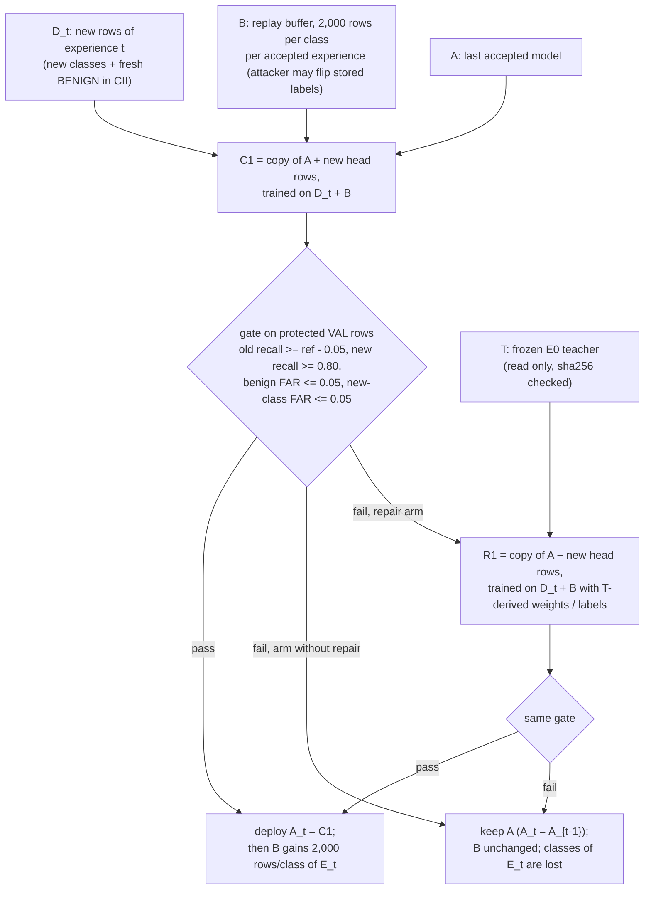

# Architecture on one page

Everything below is read from the code (`s2_model.py`, `s3_continual.py`) and the committed four-label scaler
(`experiments/results/01_data/cii/scaler.json`). The full explanation is in `PROJECT_TECHNICAL_HANDBOOK.md` sections 4-6.

## 1. The model: an FT-Transformer-style tabular Transformer (class name `TabTransformer` is historical)

```
one flow = 77 standardised numbers x_1..x_77  +  protocol (0, 6 or 17; anything else -> "unseen")
                    |                                   |
   numeric token j:  z_j = x_j * W_j + b_j            protocol token: Embedding(4, 32)[id]
   W, b: (77, 32) learned, one pair per feature        id 1/2/3 for 0/6/17, 0 = unseen in E0
                    |                                   |
   [CLS] (1, 32) learned  +  77 numeric tokens  +  1 protocol token   ->  X: (N, 79, 32)
                    |
   3 x PreNorm Transformer encoder layer   (d = 32, 4 heads of 8 dims, FFN 32 -> 128 -> 32, GELU, dropout 0.1)
       h = h + Dropout(MHSA(LayerNorm(h)))        MHSA: Q, K, V = h W_Q, h W_K, h W_V;  softmax(Q K^T / sqrt(8)) V
       h = h + Dropout(FFN(LayerNorm(h)))
                    |
   take the [CLS] position h[:, 0]  ->  LayerNorm(32)  ->  Linear(32, K)  ->  logits (N, K)
                    |
   loss: weighted cross-entropy, class weight c_k = sqrt(N / (K n_k)) times a per-row weight w (1 except in R1)
```

| Item | Value (code-derived) |
|---|---|
| Parameters | 43,363 (K = 3, RF); 43,396 (K = 4, four-label); 43,660 (K = 12) |
| New classes | `expand_head` appends output rows; old rows are copied unchanged (old logits identical) |
| Training | AdamW, lr 1e-3, weight decay 1e-4, batch 512; 10 epochs for E0, 5 per update; fp16 autocast on GPU |
| Scaler | signed log1p, then (x - mean) / std fitted on E0 training rows only, clip to [-5, 5]; frozen afterwards |

Closest published design: the Feature Tokenizer + [CLS] + PreNorm Transformer of FT-Transformer (Gorishniy et al.,
2021), at a much smaller width (32, not 192) and with GELU instead of ReGLU. It is **not** the original TabTransformer
(Huang et al., 2020), which embeds only categorical columns and concatenates raw continuous features after the
Transformer.

## 2. One continual update (what `s3_continual.run_arm` does at experience t)



- **T** is trained once on E0 and never updated; it only scores buffer rows whose stored label it knows (BENIGN, Syn).
- **Soft R1** (registered): row weight = p_T(stored label | x). **Relabel R1** (FU2, post hoc): if p_T(stored) <= 0.1
  and max p_T >= 0.9, the row's training label becomes T's prediction (weight 1). R1 never writes back to B.
- **Diagnostic R1** (`--forced-r1`): trained and gated on arms without repair, logged only, never deployed.
- Test rows are never read by any decision; they are scored once, after the validation files are committed.
